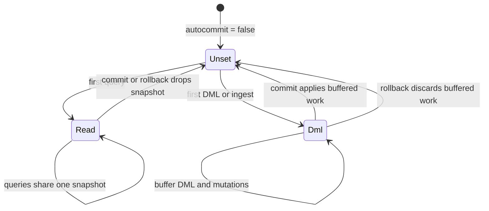

# Transactions and RPCs

How the driver uses Spanner transactions and RPCs. See [options](options.md) for configuration
and the [ADBC interface](adbc.md) for the public API. Client behavior described here is that of
the `google-cloud-spanner` revision pinned in `Cargo.lock`.

## Spanner's transaction modes

| Mode | Used for | Completion |
| --- | --- | --- |
| Read/write | DML, and commits that mix DML and mutations | Commit. The client can replay the transaction on `ABORTED`. |
| Read-only | Queries and metadata | No commit or rollback RPC. |
| Batch read-only | Partitioned queries | Partition tokens run against the same session and snapshot. |
| Write-only | Commits with only mutations (ingest) | Explicit begin, then a commit with the transaction ID. |
| Partitioned DML | Opt-in large `UPDATE` and `DELETE` | Partitions commit independently; no explicit commit. |

Read-only transactions take no locks. A single-use read carries its options on one request; a
multi-use read keeps a transaction ID and snapshot across requests. Spanner only allows bounded
staleness on single-use reads. See [Spanner transactions](https://docs.cloud.google.com/spanner/docs/transactions).

### Isolation and locking

`adbc.connection.transaction.isolation_level` sets the isolation of the driver's read/write
transactions. Queries use `spanner.read.staleness` instead, and mutation-only commits and
partitioned DML ignore the setting.

| ADBC level suffix | Spanner level | Default read lock mode |
| --- | --- | --- |
| `default`, `serializable`, `linearizable` | `SERIALIZABLE` | Pessimistic |
| `repeatable_read`, `snapshot`, `read_committed`, `read_uncommitted` | `REPEATABLE_READ` | Optimistic |

The driver leaves the read lock mode unset, so Spanner derives it from the isolation level.
Repeatable read is snapshot isolation: it permits write skew when a statement reads rows it
doesn't write, even a single autocommit statement. See
[isolation levels](https://docs.cloud.google.com/spanner/docs/isolation-levels) and
[transaction options](https://docs.cloud.google.com/spanner/docs/reference/rest/v1/TransactionOptions).
The mapping is in [connection/exec.rs](../src/connection/exec.rs).

## ADBC transactions

Autocommit is on by default. Each query runs in a single-use read-only transaction, except that
a query bound to several parameter rows shares one multi-use snapshot across its runs. DML runs
in a read/write transaction that commits before the call returns.

Setting `adbc.connection.autocommit=false` starts manual mode. The pinned client only exposes
read/write transactions as a closure it may replay, so the driver buffers writes and runs them
at commit. The first query or write decides what the transaction is:

Mixing queries and writes fails with `InvalidState`, so there is no read-your-writes. Buffered
DML and ingest return `None` from `execute_update`, and commit doesn't report a row count.
`THEN RETURN` and partitioned DML need autocommit.

A manual read transaction takes its snapshot from the first query's staleness bound, converting
`max:` and `min:` bounds to exact ones, and ignores the bounds of later queries. If the first
query fails, for example with a syntax error, the transaction hasn't begun and the next query
starts it again.
`execute_partitions` always creates its own batch snapshot and fails inside a manual write
transaction. It passes the staleness bound through unchanged, and Spanner rejects bounded
staleness for that transaction type, so use a strong, exact staleness or exact timestamp bound.

At commit, buffered DML runs as one `ExecuteBatchDml`, followed by the buffered mutations. All
mutations therefore apply after all DML, whatever order the ingests and DML were issued in.
Mutation-only work uses the write-only path, which is protected against replay. If the commit
fails, the buffer is kept. A commit that was cancelled or timed out may still have been applied,
so committing the kept work again could apply it twice; roll back to discard it. If the commit
succeeds, only the applied work is removed, so work buffered concurrently survives. Turning
autocommit back on also commits pending work.

With `adbc.connection.readonly=true`, new writes and commits of pending writes fail with
`InvalidState`, but rollback and commits of read-only or empty transactions still work.
`commit()` and `rollback()` fail with `InvalidState` in autocommit mode.

DDL always runs immediately, including the table creation or replacement done by ingest. It
doesn't start or join a manual transaction, can't be rolled back, and runs before any DML that
is already buffered. If a multi-statement schema change fails, earlier statements may stay
applied.

The implementation is in [connection.rs](../src/connection.rs),
[connection/txn.rs](../src/connection/txn.rs) and [statement.rs](../src/statement.rs).

## RPCs

| RPC | Used for |
| --- | --- |
| `CreateSession` | The client creates its multiplexed session and replaces it periodically. |
| `BeginTransaction` | Write-only, batch read-only and partitioned DML transactions, `THEN RETURN` DML bound to several rows, and as a fallback when an inline begin fails. |
| `ExecuteStreamingSql` | Queries, metadata, PLAN probes, partition reads, `THEN RETURN` and partitioned DML. |
| `ExecuteBatchDml` | Ordinary DML, including single statements, and manual DML commits. |
| `Commit` | Read/write and write-only transactions. |
| `Rollback` | Sent by the client to clean up a read/write transaction with a known ID when its body fails with an error other than `ABORTED`, or when a cancel or timeout drops it. |
| `PartitionQuery` | Descriptors for `execute_partitions`. |
| `BatchWrite` | Opt-in autocommit ingest. |
| `UpdateDatabaseDdl` | Schema changes through the gRPC Database Admin API, followed by operation polling. |

The driver doesn't use unary `ExecuteSql`, the key-based `Read`, `StreamingRead` and
`PartitionRead`, or the session pool RPCs (`BatchCreateSessions`, `GetSession`, `ListSessions`,
`DeleteSession`).

### Sessions and transaction begin

All connections from a database object share one cached client stack, though each has its own
transaction state. The client keeps a single multiplexed session, checks its age hourly and
replaces it after seven days; there is no session pool. Setting a database option discards the
cache for new connections, and existing connections keep their stack. The admin client is built
on the first DDL operation and shared by the same stack. Cloud Spanner, the emulator and Omni
are all reached over gRPC, for queries and schema changes alike.

Read/write and manual read-only transactions begin inline with their first request, so creating
a manual read-only transaction sends no RPC. Write-only, partitioned DML and batch read-only
transactions begin explicitly, as does `THEN RETURN` DML bound to several rows.

### Commit and rollback

`runner_builder` in [connection/exec.rs](../src/connection/exec.rs) configures read/write
transactions for batch DML, `THEN RETURN` DML and DML parameter planning. Write-only commits use
the client's `write` method, an explicit begin followed by `Commit(transaction_id)`, which
protects against replay. The driver doesn't use the client's at-least-once single-use mutation
commit.

On a multiplexed session, a commit can need a second `Commit` carrying a precommit token; the
follow-up carries no mutations. Separately, the client reruns whole transactions on `ABORTED`
with no default limit on attempts or time. `spanner.retry.*` doesn't limit these reruns, but
the `update` timeout does.

ADBC `rollback()` sends no RPC: it discards buffered writes or drops the read-only snapshot. The
client itself sends `Rollback` to clean up a read/write transaction whose body failed or that was
cancelled or timed out, once the transaction has an ID. A transaction interrupted during its
first request has no ID yet; see [known limitations](limitations.md#interrupted-writes-can-hold-locks).

### Streaming queries and batch DML

Query results stream in bounded Arrow chunks. The client resumes interrupted streams from the
last resume token. A long stretch of results without a token can exhaust its buffer and
disable resumption, and an error before the stream opens isn't handled by resumption at all.
See [retry tuning](options.md#retry-tuning).

`ExecuteBatchDml` runs statements in order in one read/write transaction. The driver sets
`last_statements=true` for autocommit batches and `false` for manual commits. `THEN RETURN` DML
uses `ExecuteStreamingSql` instead, and reads the returned rows inside the transaction closure.

### Partitioned queries

`execute_partitions` creates a batch read-only transaction, calls `PartitionQuery`, and gets the
Arrow schema from a separate PLAN probe. It accepts at most one row of bound parameters. A
descriptor carries the query and the original session and transaction IDs, which
`read_partition` uses even on another connection. Descriptors can be executed by anyone who
holds them and are not authenticated, so only accept them from trusted sources.

The driver has no setting for partition size or count because Spanner ignores both
[PartitionOptions](https://docs.cloud.google.com/spanner/docs/reference/rest/v1/PartitionOptions) hints.

### BatchWrite and partitioned DML

With `spanner.ingest.batch_write=true`, each row is its own mutation group. Groups commit
independently, so even one ingest chunk can partially succeed, and there is no replay
protection. Manual mode ignores the option and buffers mutations for an atomic commit. Stream
retries respect the attempt limit but not the elapsed-time limit, so use the `update` timeout as
a deadline.

`spanner.dml.partitioned=true` runs an idempotent `UPDATE` or `DELETE` as partitioned DML. It is
not atomic and reports a lower bound on affected rows. See
[statement options](options.md#statement-only-options) for the restrictions and which settings
apply to both paths.

## Limits and ingest chunks

Relevant [published limits](https://docs.cloud.google.com/spanner/quotas), as of September 2026:

| Limit | Value |
| --- | --- |
| Mutations per commit, including index changes | 80,000 |
| Mutations per DML statement, including index changes | 80,000 |
| Mutations per BatchWrite group | 80,000 |
| Commit size, including indexes and change streams | 100 MiB |
| Size of requests other than commits | 10 MiB |
| SQL text | 1 million characters |
| DDL text for one schema change | 10 MiB |
| Concurrent partitioned DML statements per database | 20,000 |

Mutation counts depend on the columns written, keys, generated and default columns, and indexes,
not just on the number of rows. Spanner publishes no limit on the number of statements in an
`ExecuteBatchDml` or DDL request, or on the number of groups in a BatchWrite.

The driver splits autocommit ingest into chunks of at most 20,000 estimated mutations and 4 MiB
of estimated row data, leaving headroom for indexes. If Spanner rejects a write-only chunk for
having too many mutations, the driver splits it in half and retries, down to single rows. A
chunk can still exceed other server limits. Manual transactions are not split.
See [statement/ingest.rs](../src/statement/ingest.rs).
